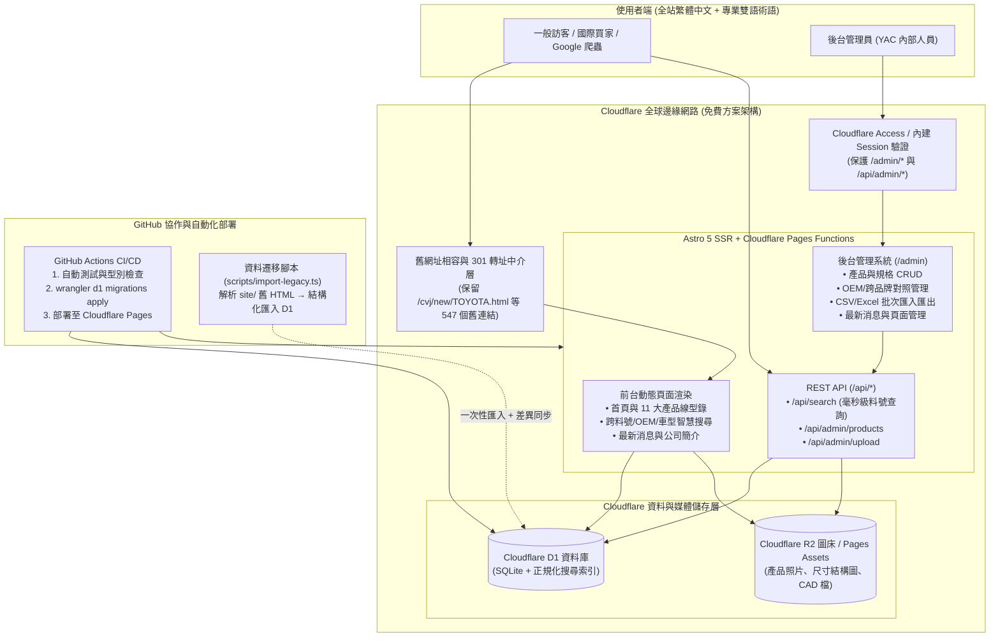
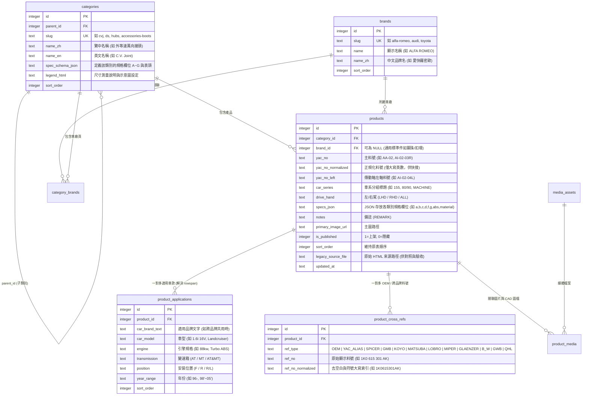
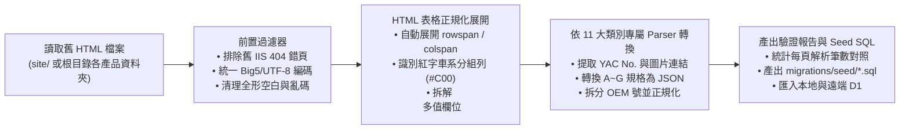

# YAC 華佑科技（www.yac.com.tw）網站動態化與後台管理系統規劃書 (`docs/PLAN.md`)

> **版本**：v1.1（Phase 1 規劃；v1.1 補上 Phase 2–4 實作後與初稿的差異）
> **實作差異摘要（以 `AGENTS.md` 為準）**：① 以原生 D1 prepared statements + 薄型別層取代 Drizzle，樣式為手寫 CSS 設計系統（非 Tailwind）；② 核心抽象為 `catalog_pages`（一列＝舊站一張規格表，`columns_json` 定義欄位），規格存 `products.specs_json`；③ Session 為無狀態 HMAC 簽章 Cookie（8 小時）＋ D1 登入限流，另支援 Cloudflare Access JWT；④ 詢價為 localStorage 詢價單 + `mailto:`；⑤ 舊靜態檔已封存到 `legacy/`（非 `site/`），動態站不讀取它；被引用的圖片複製到 `public/images/`（網址 `/images/...`），舊圖片網址與舊 `.html` 皆 301；⑥ 後台 CSV 每筆車款一列、依 YAC 料號 upsert、單次上限 200 產品；⑦ `news_posts.content_html` 以 HTML 輸出（僅管理員可編輯）。
> **目標**：將現有純靜態 HTML 網站全面升級為 **Cloudflare Pages / Workers + D1 資料庫 + R2 圖床** 之動態網站，提供全站繁體中文（含國際汽配專業術語對照）的前台型錄查詢系統，以及支援新增、修改、刪除與批次匯入的後台管理系統（CMS）。

---

## 一、現有靜態網站盤點與痛點分析

經完整掃描現有儲存庫，目前網站共包含 **8,668 個檔案**：
- **網頁檔案**：**547 個 `.html` 靜態頁面**（含部分由舊 IIS 伺服器誤存之 404 靜態頁面，如 `lockinghub/benz.html`、`2007/MA-50.html`）。
- **圖片與圖檔**：**7,840 張 `.jpg` 產品與規格圖**、**50 張 `.gif` 結構示意圖**、**204 個 `.dwg` CAD 工程圖檔**、**13 個舊版 `.swf` Flash 檔案**。

### 1.1 現有網站內容結構盤點

| 區塊 / 類別 | 現有路徑範例 | 頁面數量 | 現有表格欄位與資料特性 |
| :--- | :--- | :---: | :--- |
| **首頁與導覽** | `/index.html`, `/common/*.html` | 6 | 11 大產品線入口、頁首/頁尾透過 `script/common.js` 動態載入 |
| **公司簡介（中/英）** | `/profile.html`, `/cvj/company-1.html` | 2 | 台灣精品獎介紹、FMS 彈性製造、品質政策、廠房設備照片 |
| **最新產品 / 消息** | `/newproduct.html`, `/new-p/*.jpg` | 1+ | 新品型錄海報展示（如 ATV 傳動軸新品海報） |
| **1. 外等速萬向接頭 (C.V. Joint)** | `/cvj/cvj.html`, `/cvj/new/<BRAND>.html`, `/cvj/old/*.html` | 127 | 依車廠分頁、車系紅字分組；單一 `YAC No.` 透過 `rowspan` 對應多筆 `Car / Engine / AT·MT / Year`，規格含 `A (外齒)`、`B (油封直徑)`、`C (內齒)`、`D (螺牙)`、`F (扣環槽 F1/F2/F3)`、`G (總高)`、`ABS (齒數)` |
| **2. 傳動軸總成 (Drive Shaft)** | `/ds/ds.html`, `/ds/<Brand>.html` | 46 | 依車廠分頁、車系分組；區分左右軸 `YAC NO. (RIGHT / LEFT)`、`CAR MODEL`、`AT/MT`、`YEAR`、`LENGTH A (RH/LH)`、`B`、`C`、`D (RH/LH)` |
| **3. 內等速萬向接頭 (Inboard Joint)** | `/accessories/inboard-joints-list.html`, `/accessories/Inboard_Joints/<BRAND>.html`, `/Inboard_Joints/<BRAND>.html` | 75 | 依車廠分頁（兩處目錄重複維護）；規格含 `YAC No.`、`Car (R/L)`、`Engine`、`AT/MT`、`Year`、`A`、`B`、`C`、`D` |
| **4. 輪轂軸承 (Wheel Hubs)** | `/hubs/hubs.html`, `/hubs/<Brand>.html` | 38 | 單格內以 `<br>` 換行存放多組通用 `YAC.No.`、多組 `O.E.M.` 料號、`Year`、`F/R (前/後輪)`、`CAR`、產品縮圖 |
| **5. 四驅鎖定輪轂 (4WD Locking Hub)** | `/lockinghub/locking.html`, `/lockinghub/<brand>.html` | 13 | 規格含 `YAC`、`Car Type`、`AT/MT (含齒數與角度如 30T×45°)`、`OEM No`、`Photo`、`Material (材質)` |
| **6. 方向機 (Steering Rack)** | `/steeringrack/steeringrack.html`, `/steeringrack/<Brand>.html` (左駕), `/steeringrack/(<Brand>.html` (右駕) | 55 | 檔名以 `(` 前綴區分右駕 (RHD)；每筆資料上方有一列跨欄長條產品圖，欄位含 `YAC No.`、`OEM No.`、`L/R`、`P/M (動力/手動)`、`YEAR`、`APPLICATION`、`REMARK` |
| **7. 方向機幫浦 (Steering Pump)** | `/steeringpump/steeringpump.html`, `/steeringpump/<Brand>.html` | 36 | 欄位含 `YAC.No.`、`O.E.M.`、`Year`、`Application`、`Photo` |
| **8. 水幫浦 (Water Pump)** | `/waterpump/waterpump.html`, `/waterpump/<brand>.html` | 12 | 欄位含 `YAC`（多組通用號）、`Car Type`（跨品牌車型）、`OEM No`、`Photo` |
| **9. 煞車碟盤 (Brake Disc)** | `/brakedisc/brakedisc.html`, `/brakedisc/<Brand>.html` | 22 | 欄位含 `YAC.No.`、`O.E.M.`、`Year`、`F/R`、`Type (Disc/Drum)`、`CAR`、`Photo` |
| **10. 十字軸與傳動組件 (Universal Joint)** | `/universal_joint/universal_joint.html` 及子頁 | 51 | 包含 4 種不同表格：(a) 傳動軸組件 `Original No. / Description / Spicer No. or Part No.`、(b) 日系車十字軸 `YAC / Original / Car / Model / Year / Fig / GMB / Koyo / Matsuba / D / O / L`、(c) 歐美跨品牌對照表 `Lobro / Miper / Glaenzer / Hard Spicer / B-W / Spicer / GWB / QHL`、(d) 圖錄頁 |
| **11. 零配件 (Accessories 11 子類)** | `/accessories/*.html` | 13 | 包含 `Shafts (軸桿)`、`Boots (防塵套)`、`Tripods (三爪)`、`Cages (保持器)`、`Balls (鋼珠)`、`Circlips 1&2 (扣環)`、`Clamps (束環)`、`ABS Ring (ABS齒環)`、`Dust Shields (防塵蓋)`、`Nut (螺帽)`、`Pancake (盤式接頭)`，各自有專屬尺寸欄位 |

---

## 二、技術架構評估與選型建議

### 2.1 框架與執行環境比較：Astro vs Next.js on Cloudflare

| 評估維度 | **Astro 5 (Cloudflare Pages SSR + Islands)** ⭐ **推薦** | Next.js (App Router via `@opennextjs/cloudflare`) |
| :--- | :--- | :--- |
| **Cloudflare 免費方案相容性** | **極佳**。Worker Bundle 極小（< 500KB），CPU 執行時間通常 < 2ms，完全不會觸發 Cloudflare 免費版 10ms CPU 限制。 | 中等。React Server Components 執行層較重，冷啟動與免費方案 CPU 時間上限較容易吃緊。 |
| **SEO 與載入速度** | **極佳**。前台預設輸出零多餘 JS 的純淨 HTML，搭配 Edge Cache 可達靜態站等級的秒開速度。 | 佳，但客戶端 Hydration Payload 較大。 |
| **後台互動性 (CRUD / 表單)** | 透過 **Astro Islands (Preact / React)** 在 `/admin/*` 載入高互動表格、行內編輯與圖片上傳元件，開發體驗與 React 相同。 | 原生 React 元件。 |
| **舊網址相容與轉址** | 支援動態路由（如 `/[category]/[brand].html`）直接渲染或透過 `_redirects` / Middleware 無縫 301 轉址。 | 支援 Middleware 轉址。 |

### 2.2 最終推薦技術棧 (Tech Stack)

- **全端框架**：**Astro 5**（`output: 'server'`，搭載 `@astrojs/cloudflare` Adapter）
- **UI 與樣式**：**Tailwind CSS v4** + **Preact / React**（僅用於搜尋器與後台管理介面互動元件）
- **資料庫**：**Cloudflare D1**（Serverless SQLite，免費方案提供 5GB 容量、每日 500 萬次讀取、10 萬次寫入）
- **ORM 與 Migration 管理**：**Drizzle ORM** + **Wrangler D1 Migrations**（所有 Schema 變更嚴格存放於 `migrations/` 資料夾）
- **圖片與檔案儲存**：
  - 現有 7,840 張靜態圖片初期可直接由 Cloudflare Pages 靜態資源提供（零額外請求費用）。
  - 後台新增/替換之產品圖片與 CAD 圖檔存入 **Cloudflare R2**（免費方案 10GB 儲存、每月 1,000 萬次 Class B 讀取免費、零流量費 Egress Fee）。
- **後台身分驗證（雙層防護支援）**：
  1. **應用層內建驗證**：使用環境變數 `ADMIN_USERNAME`、`ADMIN_PASSWORD_HASH`（PBKDF2-SHA256 雜湊）與 `SESSION_SECRET`，登入後簽發 `HttpOnly; Secure; SameSite=Lax` Session Cookie 並記錄於 D1 `admin_sessions` 表。
  2. **邊緣層防護（可選啟用）**：支援直接掛載 **Cloudflare Access (Zero Trust)** 保護 `/admin/*` 與 `/api/admin/*` 路徑（免費 50 人額度，支援 Email OTP / Google / Microsoft 帳號白名單）。

### 2.3 系統架構圖 (Mermaid)



---

## 三、UI / UX 格式參考設計（前台型錄 × 後台管理）

> 💡 **互動式視覺預覽**：我們已同步在工作階段產出互動式原型預覽檔，可直接切換查看「前台 B2B 產品型錄與智慧搜尋」及「後台管理系統」的實際排版與操作體驗。

### 3.0 已定案之現代 UI 設計系統與配色規範

經多輪視覺迭代確認，本專案捨棄傳統具 Bootstrap 套版感的圓角卡片與高飽和藍色塊，採用以下現代工業設計組合：

- **前台設計系統（已定案）**：**【YAC 淺色工業藍 — Light Industrial Blue】**（靈感取自 Polestar / IBM Carbon 的直角工業語彙，融合 `mearashadowfax/ScrewFast` 的產品型錄機能，配色取自 YAC logo 之藍）
  - **零圓角與無框底線表單（`0px` Radius + Bottom-Border Inputs）**：所有按鈕、輸入框、卡片皆直角；搜尋框改用 `1.5px` 底線，避免 Bootstrap 式圓角膠囊外觀。
  - **淺色配色規範（Light Palette）**：整體以白與淡藍灰為主，不使用大面積深藍或黑色。

    | 用途 | 色碼 |
    | :--- | :--- |
    | 主色 YAC 藍（按鈕、連結、選取、大數字） | `#3A5BBD`（hover / 輔助 `#5B7BDC`） |
    | 主色淡底（選取列、標籤） | `#E8EEFB` |
    | 文字 / 標題（深石板藍） | `#22304F`（次要文字 `#66728F`） |
    | 頁面背景 / 卡片 | `#F6F8FC` / `#FFFFFF` |
    | 分隔線 | `#DDE3EF` |
    | 工具列、頁尾、圖例列底色 | `#EAF0FB` |
    | Hero 漸層 | `#F3F7FE` → `#E4ECFB` → `#D3E1F8` + 藍色細網格 |
    | Logo 輔色（僅用於 logo 角標與狀態點） | 紅 `#D2362D` / 綠 `#1F9A5A` |

  - **字體**：中文 Noto Sans TC / 微軟正黑體；料號、尺寸、標籤使用等寬字體（JetBrains Mono / Cascadia Mono）。
  - **B2B 工程型錄元素**（預覽圖：首頁、型錄頁）：
    1. **頂部工具列（Utility Bar）**：產品類別關鍵字與語言切換。
    2. **Hero + 重疊式型號快速查詢（Part Finder）**：料號 / OEM、車廠、車型三欄底線輸入，搜尋按鈕為主色藍。
    3. **Bento 產品線格狀排版**：4 大主力產品圖卡 + 「更多零件」橫列，完整涵蓋 11 大產品線。
    4. **指標列（Metrics Strip）**：產品線、車廠數、規格數、OEM 對照；**數字須由 D1 實際資料動態帶入，預覽圖的數字僅為示意**。
    5. **品質管制區**：沿用原站 YAC 球體品質圖與六大管制流程。
    6. **型錄內頁三欄版型**：左側品牌篩選 + A–Z 索引；中間頁籤（規格表 / 圖面 / OEM 對照）、A~G 尺寸圖例列與規格表；右側零件檢視器（工程圖、OEM 號、可訂購後綴 `-01` / `-02` / `-02SN`、加入詢價單）。
  - 後台沿用相同主色 `#3A5BBD` 與 `0px` 圓角規範，以維持前後台視覺一致。
- **後台設計系統（已定案）**：**【後台主題 B】[`satnaing/shadcn-admin`](https://github.com/satnaing/shadcn-admin) 極簡高密度資料表（Shadcn Data-Table + 右側 Sheet 編輯抽屜）** 風格。

| 編號 | 主題風格定位 | GitHub Repo | Stars | 線上 Demo | 視覺特色與適用度 |
| :---: | :--- | :--- | :---: | :--- | :--- |
| **前台主題 1** ⭐ | **重工機械與五金零件製造商風 (Industrial Hardware & Parts)** | [`mearashadowfax/ScrewFast`](https://github.com/mearashadowfax/ScrewFast) | ⭐ 1.4k+ | [screwfast.uk](https://screwfast.uk/products) | **最貼近汽配工廠定位**。專為五金螺絲、工業零件製造商設計，內建產品型錄格線、規格表 Tabs（Description / Specifications / Blueprints 工程圖）與客戶實績展示，可將主色改為 YAC 藍（已定案 `#3A5BBD`）。 |
| **前台主題 2** | **現代科技藍國際企業門戶風 (Modern Corporate Blue)** | [`onwidget/astrowind`](https://github.com/onwidget/astrowind) | ⭐ 6.1k+ | [GitHub Preview](https://github.com/onwidget/astrowind) | Astro 最高人氣企業模板，乾淨白底搭配科技深藍（延續現有 `index.html` 的藍色系 `#2c6da5`），適合國際外銷企業形象首頁 + 結構化產品搜尋表。 |
| **前台主題 3** | **極簡高對比專業黑白灰型錄風 (Minimalist High-Contrast)** | [`zeon-studio/astroplate`](https://github.com/zeon-studio/astroplate) | ⭐ 1.2k+ | [astroplate.netlify.app](https://astroplate.netlify.app/) | 瑞士格線極簡黑白灰排版，無多餘裝飾，將視覺焦點 100% 集中於「料號快搜列、車廠索引與高密度工程規格表」。 |
| **後台主題 A** ⭐ | **極簡高密度資料表後台 (Shadcn Data-Table CMS)** | [`satnaing/shadcn-admin`](https://github.com/satnaing/shadcn-admin) | ⭐ 16.2k+ | [shadcn-admin.netlify.app](https://shadcn-admin.netlify.app/tasks) | 支援多條件膠囊篩選（車廠/產品線）、高密度規格列表、右側滑出抽屜（Drawer）快速編輯單一料號與多車款明細。 |
| **後台主題 B** | **經典企業藍白 ERP 表格後台 (Flowbite Astro CRUD)** | [`themesberg/flowbite-astro-admin-dashboard`](https://github.com/themesberg/flowbite-astro-admin-dashboard) | ⭐ 790+ | [Products CRUD Demo](https://themesberg.github.io/flowbite-astro-admin-dashboard/crud/products/) | 原生 Astro + Tailwind 打造，傳統直覺的藍白 ERP 管理表格、頂部搜尋與彈出式「新增/修改/刪除產品」視窗。 |

### 3.1 前台 UI 格式參考：專業工業 B2B 型錄風（Industrial Precision Catalog）

針對汽配外銷與售後維修市場（Aftermarket）買家的使用習慣，前台不採用花俏卻資訊稀疏的消費型電商卡片，而是採用**「現代化高密度工程型錄介面」**（參考 Schaeffler REPXPERT、GSP、RockAuto 的專業查詢體驗）：

1. **全域置頂「智慧型號快搜列 (Smart Part Finder)」**：
   - **關鍵字直搜**：輸入 `AA-02`（YAC 料號）、`1K0 615 301 AK`（OEM 料號，自動忽略空白與連字號）、`5-279X`（Spicer 料號）或 `Landcruiser`（車型），即時列出跨類別匹配結果。
   - **三段式條件篩選**：`[選擇產品線 (11大類)]` ➔ `[選擇車廠品牌 (Audi, Toyota...)]` ➔ `[選擇車系 / 排氣量 / 左右駕]`。
2. **保留並升級老客戶熟悉的「工程規格對照表」**：
   - **置頂固定尺寸圖解卡 (Pinned Dimension Legend)**：在表格上方固定顯示該類別的工程尺寸測量圖（如 C.V. Joint 的 `A: 外齒數`、`B: 油封直徑`、`C: 內齒數`、`F1/F2/F3 扣環槽位置圖`），捲動長表格時仍可隨時對照。
   - **智慧群組與響應式凍結首欄**：保留「車系紅字分組標頭（如 `ALFA ROMEO - 155 / 164`）」與一對多車款適用清單；在平板與手機上支援**首欄（YAC 料號）固定凍結**與水平滑動。
   - **點擊料號彈出高清圖檔 Lightbox**：原本點擊料號會直接跳開成單張 `.jpg` 空白頁，改為點擊即在畫面中央彈出 **產品詳情與高清工程圖 Lightbox**（支援放大檢視、查看適用車款、OEM 對照清單與一鍵複製料號）。
3. **全站繁體中文介面 + 國際通用雙語規格標頭**：
   - 導覽列、搜尋提示、公司簡介、最新消息、頁尾與篩選器全面採用**繁體中文**。
   - 產品類別與規格表頭採用**「繁體中文 + 英文專業縮寫並陳」**（例如：`外等速萬向接頭 (C.V. Joint)`、`外齒數 A (Outer Teeth)`、`油封直徑 B (Seal Dia.)`），兼顧台灣內部管理與全球買家查表習慣。

```
+-----------------------------------------------------------------------------------+
| [YAC 華佑科技 LOGO]   產品型錄 ▾   最新產品與消息   公司簡介   聯絡我們   [後台登入] |
+-----------------------------------------------------------------------------------+
| 🔍 智慧型號搜尋：[ 輸入 YAC 料號 / OEM 原廠號 / Spicer·GMB 號 / 車型... ] [搜尋]     |
|    快速篩選：[ 全部產品線 ▾ ]  [ 選擇車廠品牌 ▾ ]  [ 全部車系 ▾ ]  [ 左/右駕 ▾ ]     |
+-----------------------------------------------------------------------------------+
| 麵包屑：首頁 > 外等速萬向接頭 (C.V. Joint) > ALFA ROMEO                            |
|                                                                                   |
| +-------------------------------+  +--------------------------------------------+ |
| | 📐 規格測量部位圖解 (點擊放大) |  | A: 外齒數 (Outer Teeth)  D: 螺牙 (Thread)   | |
| |   [ C.V. Joint 工程結構圖 ]    |  | B: 油封直徑 (Seal Dia)   F: 扣環槽 (Groove) | |
| |   訂購後綴說明：-01 / -02SN    |  | C: 內齒數 (Inner Teeth)  G: 總高 (Height)   | |
| +-------------------------------+  +--------------------------------------------+ |
|                                                                                   |
| 車廠快選：[ALFA ROMEO] [AUDI] [BENZ] [BMW] [FORD] [HONDA] [MAZDA] [NISSAN] [TOYOTA]|
|                                                                                   |
| ▼ 車系：155                                                                       |
| +-------------+---------------+------------+-------+------+----+----+----+-------+ |
| | YAC 料號    | 適用車款      | 引擎規格   | 變速箱| 年份 | A  | B  | C  | D ... | |
| +-------------+---------------+------------+-------+------+----+----+----+-------+ |
| | 🖼️ AA-02    | 1.6i 16V      | 88kw       | AT&MT | 96-  | 25 | 56 | 28 | 24/1.5| |
| | (點擊看照片) | 2.0 16V       | Turbo ABS  | AT&MT | 92-  | 25 | 56 | 28 | 24/1.5| |
| |             | 2.5 V6        | 121-122kw  | AT&MT | 92-  | 25 | 56 | 28 | 24/1.5| |
| +-------------+---------------+------------+-------+------+----+----+----+-------+ |
+-----------------------------------------------------------------------------------+
```

### 3.2 後台 UI 格式參考：高效率資料表單與類 Excel 編輯系統（Admin CMS）

為讓內部人員能輕鬆管理數千筆零件規格，後台採用 **左側功能欄 + 右側資料表格 + 側邊滑出編輯抽屜 (Slide-over Drawer)** 的現代化管理介面：

```
+------------------+----------------------------------------------------------------+
| ⚙️ YAC 管理後台  | 產品管理 > 外等速萬向接頭 (C.V. Joint)       [+ 新增產品] [匯入] |
+------------------+----------------------------------------------------------------+
| 📊 總覽儀表板    | 篩選：[車廠: ALFA ROMEO ▾] [車系: 全部 ▾] [搜尋料號/OEM...]    |
| 📦 產品型錄管理  |----------------------------------------------------------------|
|   ├ 外萬向接頭   | ☑ | 縮圖 | YAC 料號 | 車廠 | 車系 | 適用車款數 | A/B/C 規格 | 操作 |
|   ├ 傳動軸總成   |---|------|----------|------|------|------------|------------|------|
|   ├ 內萬向接頭   | ☐ | [圖] | AA-02    | ALFA | 155  | 4 款車型   | 25/56/28   | 編輯 |
|   ├ 輪轂軸承     | ☐ | [圖] | AA-01    | ALFA | 164  | 6 款車型   | 27/56/28   | 編輯 |
|   ├ 四驅鎖定輪轂 | ☐ | [圖] | AA-03    | ALFA | GTV  | 1 款車型   | 27/59/26   | 編輯 |
|   ├ 方向機(左/右)|----------------------------------------------------------------|
|   ├ 方向機幫浦   | ✏️ 右側滑出「編輯產品 AA-02」抽屜視窗：                         |
|   ├ 水幫浦       |   • 基本資料：YAC 料號 [AA-02]  車廠 [ALFA ROMEO]  車系 [155]   |
|   ├ 煞車碟盤     |   • 產品照片：[拖曳上傳新圖片至 R2] (目前：/cv-joint/aa-02.jpg) |
|   ├ 十字軸與組件 |   • 動態規格欄位 (依類別自動切換)：                             |
|   └ 零配件(11類) |     A 外齒數 [25]  B 油封直徑 [56]  C 內齒數 [28]  D [24/1.5]   |
| 🔄 OEM/型號對照  |     F 扣環槽 [F3]  G 總高 [148]     ABS 齒數 [44]               |
| 📰 最新消息管理  |   • 適用車款明細 (可動態新增多列)：                             |
| 📄 公司頁面管理  |     1. [1.6i 16V] [88kw] [AT&MT] [96-] [刪除]                  |
| 🖼️ 圖片媒體庫    |     2. [2.0 16V]  [Turbo ABS] [AT&MT] [92-] [刪除]             |
| 📥 批次匯入/匯出 |   • OEM 與跨品牌對照號 (標籤輸入)：[+ 新增 OEM 號]              |
| 🛡️ 操作稽核紀錄  |                                         [取消]  [💾 儲存變更]   |
+------------------+----------------------------------------------------------------+
```

---

## 四、資料庫結構設計（Cloudflare D1 / SQLite）

由於 11 大產品線與 11 種零配件的規格欄位差異極大，我們採用**「關聯式核心資料表 + 類別動態規格 Schema (`specs_json`) + 正規化檢索索引表」**混合架構，兼顧查詢效能與後台表單彈性。

所有結構變更皆透過 `migrations/0001_initial_schema.sql` 管理：

### 4.1 ER 關聯圖 (Mermaid)



### 4.2 其他系統資料表

| 資料表名稱 | 用途說明 | 主要欄位 |
| :--- | :--- | :--- |
| **`news_posts`** | 最新產品 / 最新消息管理（取代 `newproduct.html`） | `id`, `slug`, `title_zh`, `title_en`, `summary`, `content_html`, `cover_image_url`, `is_pinned`, `is_published`, `published_at`, `created_at` |
| **`site_pages`** | 靜態頁面與區塊內容管理（如 `profile.html` 中文簡介、`company-1.html` 英文簡介、頁尾聯絡資訊） | `id`, `page_key` (`company_profile_zh`, `company_profile_en`, `contact_info`), `title`, `content_json`, `updated_at` |
| **`media_assets`** | 圖片與 CAD 工程檔管理（對應 R2 或靜態目錄） | `id`, `storage_key`, `public_url`, `file_name`, `mime_type`, `file_size`, `category_slug`, `created_at` |
| **`legacy_redirects`** | 舊站 547 個 `.html` 路徑轉址與相容對應表 | `old_path` (PK, 如 `/cvj/new/ALFA_ROMEO.html`), `new_path` (如 `/catalog/cvj/alfa-romeo`), `status_code` (`301` 或 `200`), `is_broken_404` |
| **`admin_users`** | 後台管理員帳號（支援環境變數種子帳號與多管理員擴充） | `id`, `username`, `password_hash`, `display_name`, `role`, `last_login_at`, `is_active` |
| **`admin_sessions`** | 後台登入 Session 狀態管理 | `id` (Token Hash), `user_id`, `expires_at`, `ip_address`, `user_agent` |
| **`admin_audit_logs`** | 後台新增/修改/刪除操作稽核紀錄 | `id`, `user_id`, `action` (`CREATE`/`UPDATE`/`DELETE`/`IMPORT`), `target_table`, `target_id`, `diff_json`, `created_at` |

### 4.3 各產品類別 `spec_schema_json` 欄位映射設計

透過在 `categories.spec_schema_json` 定義欄位結構，**同一套後台程式碼即可支援全站 22 種不同規格表**：

1. **外等速萬向接頭 (`cvj`)**：`outer_teeth_a`, `seal_dia_b`, `inner_teeth_c`, `thread_d`, `circlip_groove_f`, `overall_height_g`, `abs_teeth`
2. **傳動軸總成 (`ds`)**：`length_a_rh`, `length_a_lh`, `outboard_teeth_b`, `seal_dia_c`, `inboard_d_rh`, `inboard_d_lh`
3. **內等速萬向接頭 (`inboard-joints`)**：`outer_teeth_a`, `seal_dia_b`, `inner_teeth_c`, `dimension_d`
4. **輪轂軸承 (`hubs`)**：透過 `product_applications` (`position`: F/R, `car_model`, `year_range`) + `product_cross_refs` (`OEM`, `YAC_ALIAS`)
5. **四驅鎖定輪轂 (`lockinghub`)**：`spline_spec` (如 `30T×45°`), `material` (如 `Aluminum Alloy`)
6. **方向機 (`steeringrack`)**：`drive_hand` (`L`/`R`), `steering_type` (`P` 動力 / `M` 手動)
7. **方向機幫浦 (`steeringpump`) & 水幫浦 (`waterpump`)**：透過 `product_applications` + `product_cross_refs` (`OEM`)
8. **煞車碟盤 (`brakedisc`)**：`disc_type` (`Disc`/`Drum`), `position` (`F`/`R`)
9. **十字軸與傳動組件 (`universal-joint`)**：`part_description`, `fig_type`, `dim_d_mm`, `dim_o_mm`, `dim_l_mm` + 跨品牌對照 (`SPICER`, `GMB`, `KOYO`, `MATSUBA`, `LOBRO`, `MIPER`, `GLAENZER`, `B_W`, `GWB`, `QHL`)
10. **零配件 11 子類 (`accessories-*`)**：依各子表定義 `length_a`~`e`、`od_a`、`id_b`、`height_c`、`drawing_type`、`specification` 等欄位。

---

## 五、後台管理系統（Admin CMS）功能清單

1. **安全登入與權限控管 (`/admin/login`)**
   - 支援 Cloudflare Access (Zero Trust) 或內建帳密登入（密碼雜湊與 Session Secret 僅存於環境變數 / Wrangler Secrets）。
   - Session 自動過期、登出、登入失敗頻率限制（Rate Limiting）。
2. **營運總覽儀表板 (`/admin`)**
   - 顯示各產品線零件總數、車廠數量、OEM 對照總筆數、近期修改紀錄與快捷操作入口。
3. **產品與規格管理 (`/admin/products`)**
   - 依 11 大產品線與車廠品牌快速篩選、關鍵字（YAC 料號 / OEM 號 / 車型）即時搜尋。
   - **新增 / 修改 / 刪除產品**：
     - 根據所選產品類別自動渲染對應的 A~G 規格欄位。
     - 支援動態新增/排序多筆「適用車款（Car Model / Engine / AT·MT / Year）」明細。
     - 支援多筆「OEM 原廠料號」、「通用 YAC 料號」與「跨品牌對照號（Spicer / GMB / Koyo 等）」標籤式增刪。
     - 支援排序權重調整與一鍵上/下架切換。
4. **圖片與 CAD 媒體庫管理 (`/admin/media`)**
   - 拖曳上傳產品照片（`.jpg`/`.png`/`.webp`）或工程圖檔（`.dwg`）至 Cloudflare R2。
   - 自動綁定對應 YAC 料號，並支援預覽現有靜態圖片路徑。
5. **CSV / Excel 批次匯入與匯出 (`/admin/import-export`)**
   - 工廠內部常以 Excel 維護型錄：提供依產品類別下載標準 CSV/Excel 範本、上傳預覽差異（新增 N 筆、更新 M 筆），確認後批次寫入 D1。
6. **最新產品與消息管理 (`/admin/news`)**
   - 新增、編輯、刪除最新產品公告與型錄海報（支援多圖上傳、置頂排序、上下架）。
7. **公司簡介與全站資訊管理 (`/admin/pages`)**
   - 可視化編輯中文/英文公司簡介內容、頁尾工廠地址、電話、傳真與聯絡信箱（`yac106@yac.com.tw`）。
8. **操作稽核日誌 (`/admin/audit-logs`)**
   - 完整記錄每次新增、修改、刪除與批次匯入的時間、操作帳號與修改前後差異（JSON Diff），防止誤刪資料且可隨時回溯。

---

## 六、舊頁面資料如何匯入資料庫（Data Migration Pipeline）

為確保現有 **547 個 HTML 頁面**中的數千筆產品資料 100% 準確轉移且零遺漏，我們將撰寫自動化解析與驗證腳本 `scripts/migrate-legacy-html.ts`（使用 `cheerio` 解析 HTML DOM）：

### 6.1 匯入處理流程



### 6.2 關鍵資料清洗規則

1. **`rowspan` 跨列自動展開（關鍵！）**：
   - 在 `cvj/new/*.html` 與 `universal_joint/*01.html` 中，同一個 `YAC No.` 與 `A~G` 規格常以 `<td rowspan="4">` 跨越 4 列不同車款，甚或中間穿插 `Engine` 或 `Year` 的局部 `rowspan="2"`。
   - 解析器會先將每個 `<table>` 轉為二維虛擬矩陣（2D Grid Matrix），將所有 `rowspan` / `colspan` 精準填充還原後，再將同一個 `YAC No.` 聚合為 1 筆 `products` 主檔 + N 筆 `product_applications` 車款明細。
2. **`<br>` 多值自動拆解**：
   - 在 `hubs/*.html`、`brakedisc/*.html`、`waterpump/*.html`、`steeringpump/*.html` 中，單一儲存格包含多筆 `YAC.No.`（如 `AI-001-WH<br>VW-002-WH`）或多筆 `O.E.M.`（如 `1J0 501 477 A<br>1J0 501 611A`）。
   - 解析器會依 `<br>` 與換行拆分為獨立的 `product_cross_refs` 紀錄，並自動建立移除空白與連字號的 `ref_no_normalized` 索引。
3. **無效頁面與重複目錄去重**：
   - 自動偵測內含 `404 - File or directory not found` 的舊損毀 HTML（如 `lockinghub/benz.html`、`2007/MA-50.html`、`2007/PR-01.html`），標記於匯入報告中不寫入錯誤資料。
   - 針對 `/Inboard_Joints/*.html` 與 `/accessories/Inboard_Joints/*.html` 兩份重複目錄，以較完整之 `/accessories/Inboard_Joints/` 為主並合併差異（如 `/Inboard_Joints/TIBA.html`）。
4. **自動化筆數驗收（Reconciliation Check）**：
   - 腳本執行後會產出 `docs/MIGRATION_REPORT.md`，逐一比對每個舊 HTML 檔案中的原始資料列數與匯入資料庫後的列數，確保 **100% 零掉單**。

---

## 七、現有網址保留與 301 轉址策略（SEO 零損失方案）

為確保 Google 已收錄的所有舊網址、外部貿易商書籤與型錄連結完全不會失效（不出現 404）：

| 舊網址類型 | 舊路徑範例 | 新版處理策略 | HTTP 狀態碼 |
| :--- | :--- | :--- | :---: |
| **首頁 / 公司簡介 / 新品** | `/index.html`, `/profile.html`, `/newproduct.html`, `/cvj/company-1.html` | 原路徑直接相容渲染，並將 `.html` 301 轉址至標準語意路徑（`/`, `/about`, `/news`） | `200` / `301` |
| **11 大產品線總覽頁** | `/cvj/cvj.html`, `/ds/ds.html`, `/hubs/hubs.html`, `/lockinghub/locking.html`, `/steeringrack/steeringrack.html`, `/steeringpump/steeringpump.html`, `/waterpump/waterpump.html`, `/brakedisc/brakedisc.html`, `/universal_joint/universal_joint.html`, `/accessories/accessories.html`, `/accessories/inboard-joints-list.html` | 透過 Cloudflare `_redirects` 或 Astro Middleware 301 永久轉址至 `/catalog/<category-slug>` | `301` |
| **各車廠規格表頁（含大小寫與特殊字元）** | `/cvj/new/ALFA_ROMEO.html`, `/ds/Audi.html`, `/steeringrack/(Toyota.html`, `/accessories/Inboard_Joints/TOYOTA.html`, `/cvj/old/toyota-1.html` | 建立完整 547 筆映射表，自動將舊路徑（含右駕 `(` 號與空白 `%20`）301 轉址至 `/catalog/<category>/<brand>`（如 `/catalog/steeringrack/toyota?hand=RHD`） | `301` |
| **舊版靜態產品圖片路徑** | `/cvj/new/AA-02.jpg`, `/cv-joint/aa-02.jpg`, `/hubs/Hubs/AI-001-WH.jpg`, `/accessories/images/abs/ab0001.jpg` | 原路徑 100% 保留靜態存取或 R2 Proxy 映射，確保 Google 圖片搜尋不失效 | `200` |

---

## 八、分階段上線步驟（Phased Rollout Plan）

遵循協作規則，所有階段皆採「**獨立分支 + PR 審核 + 舊站 `site/` 零中斷**」推進：

### Phase 1：架構評估與計畫確認（本階段 — PR #1）
- [x] 完整盤點現有 8,668 個靜態檔案與 11 大產品線資料結構。
- [x] 產出 `docs/PLAN.md`（架構圖、D1 資料表設計、UI 參考、資料匯入與分階段計畫）。
- [x] 建立根目錄 `AGENTS.md` 與 `.env.example` 協作規範。
- [ ] 與使用者確認技術選型（Astro + D1）與前後台 UI 設計風格。

### Phase 2：專案骨幹、D1 Schema Migration 與舊資料自動匯入（PR #2）
- [x] 初始化 Astro + TypeScript + `wrangler.toml`（未採 Tailwind / Drizzle，見上方差異摘要）。
- [x] 建立 `migrations/0001_initial_schema.sql` 並通過本機 D1 測試。
- [x] 開發 `scripts/migrate-legacy-html.ts` 解析全部舊 HTML 表格，產出 Seed SQL 與驗收報告（舊靜態檔完全不動）。

### Phase 3：前台動態網站、智慧搜尋與舊網址 301 轉址（PR #3）
- [x] 實作全站繁體中文前台：首頁、11 大產品線導覽、各車廠動態規格表、圖片 Lightbox 預覽、公司簡介與最新產品頁。
- [x] 實作跨類別智慧搜尋 API（支援 YAC 料號、OEM 號、Spicer/GMB 號、車型模糊與精準查詢）。
- [x] 實作全站 547 個舊 `.html` 網址的 301 轉址。

### Phase 4：後台管理系統（登入驗證 + CRUD + R2 圖片上傳 + 批次匯入）（PR #4）
- [x] 實作後台身分驗證中介層（支援環境變數帳密 + Session 及 Cloudflare Access）。
- [x] 實作產品 CRUD、動態規格表單、適用車款與 OEM 對照號編輯器。
- [x] 實作 R2 圖片上傳、最新消息 CRUD、公司頁面編輯、CSV 批次匯入匯出與稽核日誌。

### Phase 5：Staging 雙軌驗證與正式切換上線（PR #5）
- [ ] 建立真實 Cloudflare D1 / R2 / secrets，套用遠端 migration 並匯入 seed。
- [ ] 在 Cloudflare Pages Preview 環境完整驗證前台搜尋、後台增刪改、舊連結 301 轉址與手機版體驗。
- [ ] 切換 GitHub Actions 部署流程至新版動態架構，完成正式上線。
